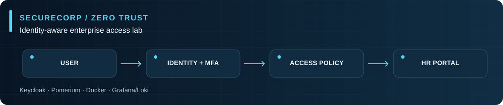
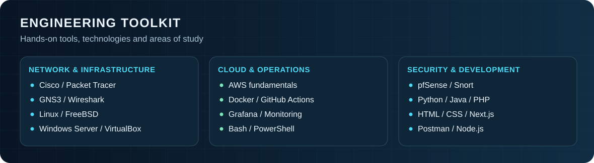
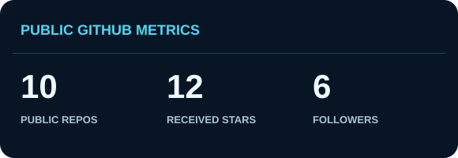
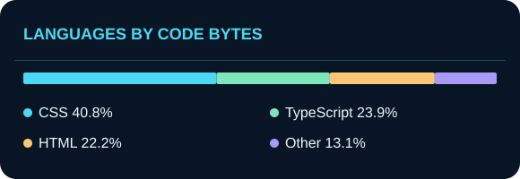

<!-- Fayaj Ahamad | Professional Network Engineering / Cloud Infrastructure GitHub Profile -->

  

   

  **Third-year BSc (Hons) Computer Networks undergraduate at NSBM Green University**  
  **Network Engineering · Cloud Infrastructure · Cybersecurity · IT Operations**

  
  
  
  

  [About](#about-me) · [Projects](#featured-engineering-projects) · [Skills](#technical-toolkit) · [GitHub Metrics](#github-metrics) · [Contact](#connect)

---

## About Me

I am **Fayaj Ahamad**, a third-year student pursuing a **BSc (Hons) in Computer Networks at NSBM Green University**, Sri Lanka.

My interests span **network engineering, cloud infrastructure, cybersecurity and IT operations**. I develop practical lab environments to explore routing and switching, TCP/IP networking, subnetting, VLANs, network security, Linux administration, monitoring and automation.

I particularly enjoy troubleshooting complex network behavior, understanding the security implications of infrastructure decisions, and converting theory into documented, reproducible projects.

**Career direction:** I am building toward an internship and long-term career in **Network Engineering, Cloud Engineering or Infrastructure Operations**.

### Current Focus

- **Enterprise networking:** routing, switching, VLANs, TCP/IP and troubleshooting
- **Cloud and infrastructure:** AWS concepts, Linux, Docker and infrastructure operations
- **Observability:** monitoring systems, dashboards, telemetry and alerting
- **Network security:** segmentation, firewalls, intrusion detection and identity-aware access
- **Engineering practice:** technical documentation, verification evidence and version control

---

## Featured Engineering Projects

These five repositories represent my practical work across network security, unified communications, monitoring and infrastructure operations. The diagrams are **conceptual overviews**, not claims of production deployment or precise packet-level architecture.

### 01 / SecureCorp — Zero Trust Enterprise Lab

A hands-on enterprise access-security lab exploring **identity-based access, MFA, authorization policies and observability**. The project combines application access controls with repeatable security testing and monitoring.

**Focus:** Zero Trust principles · Keycloak · Pomerium · Docker · Grafana / Loki  
**Engineering value:** authenticated access flows, access-policy validation, and documented security checks.

**[Explore repository →](https://github.com/fayajahamad/securecorp-zero-trust-enterprise-lab)**

### 02 / FreeBSD — Asterisk VoIP Lab

A practical **voice infrastructure and PBX lab** focused on applying SIP and VoIP concepts in a FreeBSD environment with Asterisk. This project demonstrates an interest in real networking protocols beyond traditional routing and switching.

**Focus:** FreeBSD · Asterisk PBX · SIP / VoIP · virtualized lab environments  
**Engineering value:** network service configuration, protocol learning and voice-network troubleshooting.

**[Explore repository →](https://github.com/fayajahamad/freebsd-asterisk-voip-lab-)**

### 03 / pfSense Firewall and Snort IDS Lab

An isolated network-security lab for investigating **firewall configuration, traffic filtering and intrusion-detection visibility** with pfSense and Snort. The emphasis is on understanding why traffic is permitted, rejected or flagged.

**Focus:** pfSense · Snort IDS · network segmentation · traffic-policy testing  
**Engineering value:** firewall rule analysis, security monitoring and lab validation.

**[Explore repository →](https://github.com/fayajahamad/pfSense-Firewall-and-Snort-IDS-Lab)**

### 04 / Enterprise NOC Monitoring Stack

A container-based observability project introducing **network operations center (NOC) workflows**, time-series metrics, monitoring dashboards and operational alerting. It explores how telemetry can support proactive infrastructure troubleshooting.

**Focus:** Docker · Prometheus · Grafana · monitoring / alerts  
**Engineering value:** infrastructure observability, metric visualization and operational awareness.

**[Explore repository →](https://github.com/fayajahamad/enterprise-noc-monitoring-stack)**

### 05 / Python Basic Network Monitor

A Python-based network-monitoring project focused on **host availability, latency checks and basic alerting/reporting**. It reflects my interest in automating everyday network administration and troubleshooting tasks.

**Focus:** Python · ICMP · latency analysis · CSV logging · threshold-based alerts  
**Engineering value:** scripting, basic fault detection and structured operational data.

**[Explore repository →](https://github.com/fayajahamad/basic-network-monitor)**

---

## Technical Toolkit

  

<b>View detailed skills and environments</b>

| Area | Tools and technologies |
| --- | --- |
| **Networking** | Cisco Packet Tracer, GNS3, Wireshark, TCP/IP, VLANs, subnetting, routing and switching |
| **Operating Systems** | Linux, FreeBSD, Windows Server |
| **Security** | pfSense, Snort IDS, access control and network-security labs |
| **Cloud / DevOps** | AWS (learning), Docker, GitHub Actions, Git, Bash, PowerShell |
| **Monitoring** | Grafana, Prometheus, Python-based network monitoring |
| **Programming** | Python, Java, PHP, HTML, CSS, JavaScript, Next.js, Node.js |
| **Developer tools** | VS Code, IntelliJ IDEA, NetBeans, Postman, XAMPP, WAMP |
| **Virtualization** | Oracle VirtualBox |
| **Voice / UC** | FreeBSD, Asterisk, SIP/VoIP |

### Networking Foundations

`TCP/IP` · `IPv4 Subnetting` · `VLANs` · `Routing & Switching` · `Troubleshooting` · `Network Security` · `Linux Administration`

**Learning:** CCNA-aligned networking fundamentals (knowledge and self-study; **not a claim of CCNA certification**).

---

## GitHub Metrics

  
  

Numbers are generated using the GitHub REST API from public repositories, then refreshed by a scheduled GitHub Actions workflow. No manually inflated counts. Language percentages describe GitHub's reported code-byte totals across public repositories, not professional proficiency.

---

## How I Approach Engineering Work

1. **Design:** define the objective, constraints and a clear lab architecture.
2. **Implement:** configure the environment and keep repeatable setup notes.
3. **Test:** validate expected behavior and investigate unexpected results.
4. **Document:** capture commands, screenshots, architecture decisions and limitations.
5. **Improve:** use findings to strengthen reliability, security and operational visibility.

> **Interested in Network Engineering, Cloud Infrastructure and Infrastructure Operations internships.** I value practical problem-solving, collaborative learning and clear technical communication.

---

## Connect

[**LinkedIn**](https://www.linkedin.com/in/fayajahamadameer/)  ·  [**Email**](mailto:fayajahamedameer@gmail.com)  ·  [**Portfolio**](https://my-portfolio-ruby-sigma-45hja9i8df.vercel.app/)  ·  [**GitHub Projects**](https://github.com/fayajahamad?tab=repositories)

